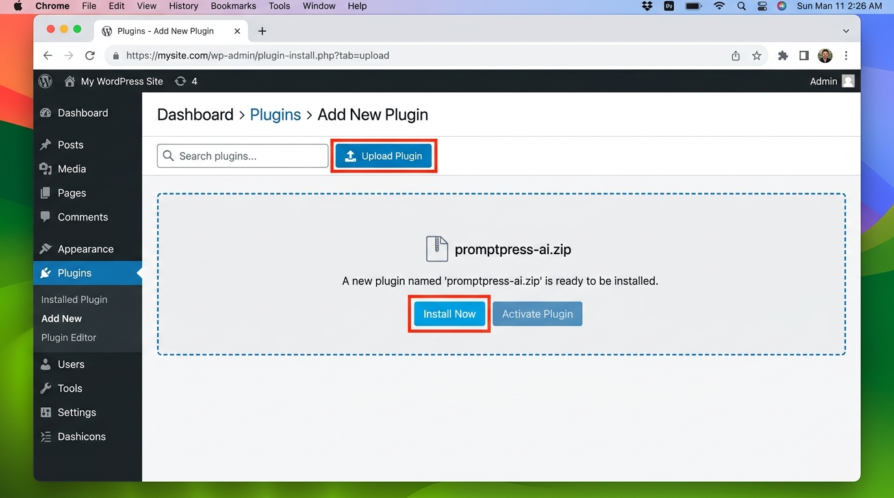
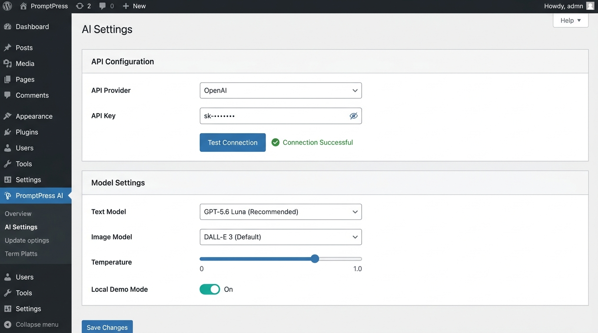
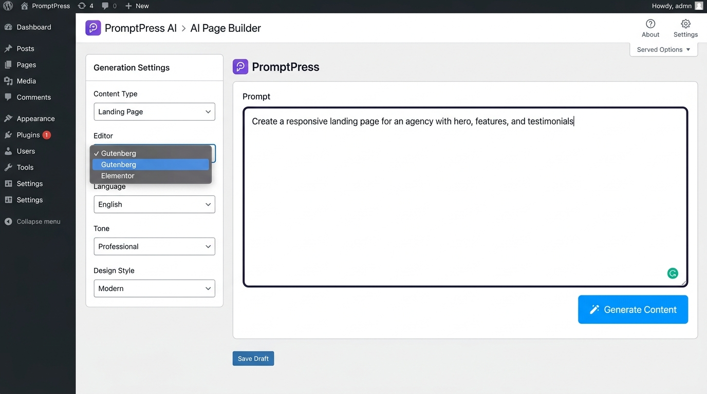
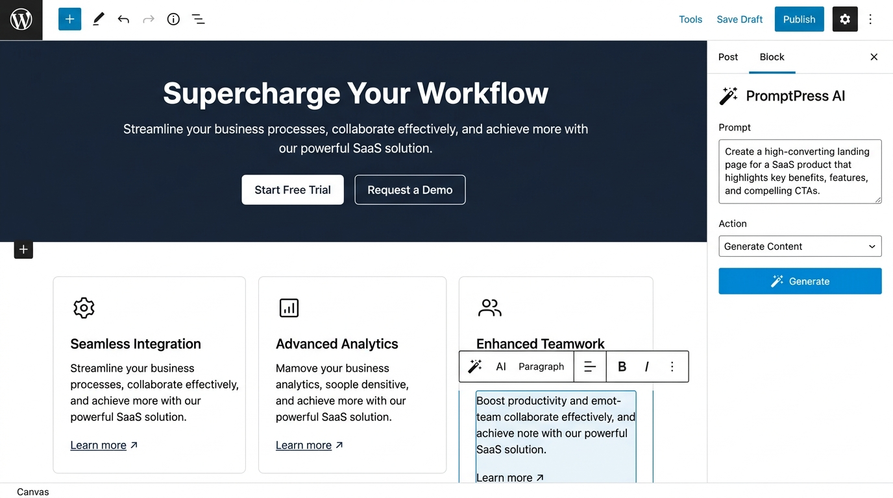
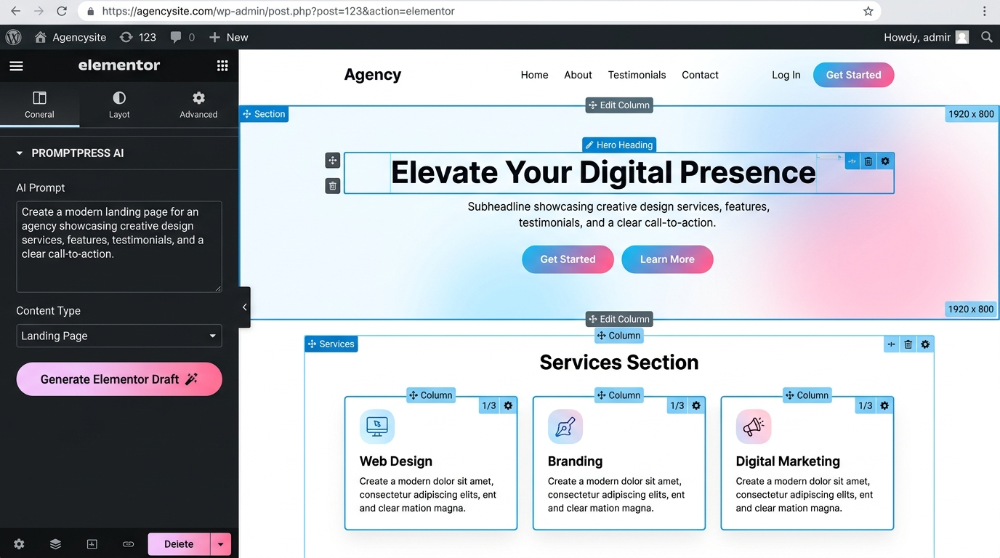

# PromptPress AI — AI-Powered Page & Content Builder for WordPress

<p align="center">
  
</p>

<p align="center">
  <strong>Generate full WordPress pages, landing pages, and blog posts from natural-language prompts — fully editable in Gutenberg and Elementor.</strong>
</p>

<p align="center">
  <a href="#installation"></a>
  <a href="#installation"></a>
  <a href="#elementor-integration"></a>
  <a href="#gutenberg-integration"></a>
  <a href="#license"></a>
</p>

---

## Table of Contents
1. [Overview](#overview)
2. [Key Features](#key-features)
3. [Plugin Installation (Step-by-Step with Screenshot)](#plugin-installation-step-by-step)
   - [Method 1: Install via WordPress Admin (Recommended)](#method-1-install-via-wordpress-admin-recommended)
   - [Method 2: Manual FTP / Directory Upload](#method-2-manual-ftp--directory-upload)
4. [Admin-Side Settings & Configuration](#admin-side-settings--configuration)
   - [AI Settings (API Key, Models & Engine)](#1-ai-settings-promptpress-ai--ai-settings)
   - [Brand Settings (Identity, Colors & Voice)](#2-brand-settings-promptpress-ai--brand-settings)
   - [Testing the API Connection](#3-verifying-the-connection)
   - [Local Demo Mode (Zero-Cost Testing)](#4-local-demo-mode)
5. [How to Create Pages in Gutenberg Block Editor](#how-to-create-pages-in-gutenberg-block-editor)
   - [Approach A: Using the PromptPress AI Builder](#approach-a-generate-gutenberg-pages-from-promptpress-ai-builder)
   - [Approach B: Directly Inside the Gutenberg Editor](#approach-b-use-promptpress-ai-directly-inside-the-gutenberg-editor)
   - [Using Gutenberg AI Quick Actions Toolbar](#using-gutenberg-ai-quick-actions-toolbar)
6. [How to Create Pages in Elementor Page Builder](#how-to-create-pages-in-elementor-page-builder)
   - [Prerequisites](#prerequisites)
   - [Approach A: Generate Elementor Pages from PromptPress AI Builder](#approach-a-generate-elementor-pages-from-promptpress-ai-builder)
   - [Approach B: Use the PromptPress AI Widget Inside Elementor](#approach-b-use-the-promptpress-ai-widget-inside-elementor)
7. [Template Library & History](#template-library--history)
8. [Troubleshooting & FAQs](#troubleshooting--faqs)
9. [License](#license)

---

## Overview

**PromptPress AI** bridges modern artificial intelligence with native WordPress editing workflows. Rather than locking you into proprietary, inflexible templates or dumping static HTML into your posts, PromptPress AI constructs genuine, editable WordPress blocks and Elementor widget trees.

Describe what you need in plain English (or 9+ other languages), and PromptPress AI writes compelling copy, structures responsive columns and sections, generates accompanying AI imagery, and styles elements according to your brand colors and tone of voice.

---

## Key Features

* 🚀 **Prompt-to-Page Generation**: Create landing pages, sales funnels, service pages, and blog posts from simple descriptions.
* 🧱 **Native Gutenberg Integration**: Generates real `core/heading`, `core/paragraph`, `core/columns`, `core/buttons`, `core/cover`, and `core/group` blocks.
* 🎨 **Native Elementor Builder Integration**: Automatically creates Elementor documents using Elementor Containers and core widgets; includes a dedicated **PromptPress AI Elementor Widget**.
* ✍️ **In-Editor AI Assistant**: Rewrite, expand, summarize, improve, and translate existing paragraphs and sections directly within the block editor.
* 🎯 **Brand Identity & Voice**: Set global brand colors, logos, preferred fonts, target audience, and writing tones so AI content remains consistent.
* 🧪 **Local Demo Mode**: Test and evaluate all Gutenberg and Elementor generation flows offline without consuming OpenAI API credits.
* 🔒 **Secure Server-Side Execution**: API keys are securely stored in WordPress options and never exposed to the frontend or public visitors.

---

## Plugin Installation (Step-by-Step)

### Method 1: Install via WordPress Admin (Recommended)

1. **Download the Plugin**: Obtain the `promptpress-ai.zip` release archive.
2. **Open Plugins Screen**: In your WordPress Admin Dashboard, navigate to **Plugins > Add New** (or **Plugins > Add New Plugin** in WP 6.5+).
3. **Upload Plugin**: Click the **Upload Plugin** button located at the top of the screen.
4. **Choose File**: Click **Choose File** and select `promptpress-ai.zip` from your computer.
5. **Install**: Click **Install Now**.
6. **Activate**: Once the upload finishes, click the blue **Activate Plugin** button.



> **Confirmation**: After activation, a new menu item labeled **PromptPress AI** will appear in your WordPress Admin sidebar with an admin page icon.

---

### Method 2: Manual FTP / Directory Upload

1. Extract the `promptpress-ai.zip` archive on your local machine to obtain the `promptpress-ai` folder.
2. Connect to your WordPress server via FTP, SFTP, or your hosting control panel's File Manager.
3. Upload the `promptpress-ai` folder into the `/wp-content/plugins/` directory:
   ```text
   /wp-content/plugins/promptpress-ai/
   ├── promptpress-ai.php
   ├── admin/
   ├── assets/
   ├── includes/
   ├── integrations/
   └── templates/
   ```
4. Log in to your WordPress Admin dashboard and go to **Plugins > Installed Plugins**.
5. Locate **PromptPress AI** in the list and click **Activate**.

---

## Admin-Side Settings & Configuration

Before generating content with AI, configure your provider API key and generation preferences. All settings are managed under the **PromptPress AI** menu in the WordPress Admin sidebar.



### 1. AI Settings (`PromptPress AI > AI Settings`)

Navigate to **PromptPress AI > AI Settings** in your WordPress dashboard.

| Setting Section | Field | Description | Recommended Setting |
| :--- | :--- | :--- | :--- |
| **API Configuration** | **API Provider** | The AI engine provider to use for generation. | `OpenAI` |
| | **API Key** | Your OpenAI secret key (starts with `sk-...`). Click the eye icon to toggle visibility. | `sk-...` (from [OpenAI API Keys](https://platform.openai.com/api-keys)) |
| **Model Settings** | **Text Model** | Large Language Model used for page structure, copy, and layout. | `GPT-5.6 Luna (Recommended)` or `GPT-4o` |
| | **Image Model** | Image generation model used when AI image source is enabled. | `GPT Image 1 Mini` or `GPT Image 1.5` |
| | **Temperature** | Controls AI creativity vs predictability (range: `0.0` to `2.0`). | `0.7` (balanced creativity & precision) |
| | **Max Tokens** | Maximum output token limit for generated responses. | `12,000` (8,000–16,000 for complete landing pages) |
| **Local Demo Mode** | **Demo Mode Toggle** | Enables offline simulation of generation without making API calls or spending credits. | `Off` for production, `On` for evaluation |
| **Debug** | **Debug Logging** | Records detailed REST API requests and responses in debug logs for troubleshooting. | `Disabled` (Enable only if diagnosing API issues) |

#### How to configure:
1. Select **OpenAI** under **API Provider**.
2. Paste your OpenAI API key into the **API Key** field.
3. Select your preferred **Text Model** (`GPT-5.6 Luna` or `GPT-4o`).
4. Select your preferred **Image Model**.
5. Keep the default **Temperature** (`0.7`) and **Max Tokens** (`12000`).
6. Click **Test Connection** to verify your key.
7. Click **Save Settings** at the bottom of the page.

---

### 2. Brand Settings (`PromptPress AI > Brand Settings`)

Configure your brand identity so that all AI-generated copy, headings, and color palettes automatically reflect your brand style.

* **Brand Identity**:
  * **Brand Name**: Enter your company, brand, or project name (e.g., *Acme SaaS*).
  * **Brand Description**: A brief summary of what your business does and its value proposition.
  * **Brand Logo**: Upload your official logo from the WordPress Media Library to be used across generated layouts.
* **Brand Colors**:
  * **Primary Color**: Used for hero sections, main headings, and primary buttons (e.g., `#0073aa`).
  * **Secondary Color**: Used for accents, subheadings, and secondary buttons.
  * **Accent Color**: Used for badges, callouts, and highlights.
* **Brand Voice**:
  * **Font Preference**: Choose between `System Default`, `Sans-Serif`, `Serif`, `Monospace`, or `Display`.
  * **Writing Tone**: Select the tone of voice (`Professional`, `Casual`, `Friendly`, `Formal`, `Persuasive`, `Informative`, `Enthusiastic`).
  * **Target Audience**: Specify who you are speaking to (e.g., *B2B founders, marketing managers, fitness enthusiasts*).
  * **Custom Brand Instructions**: Add specific guidelines, prohibited terms, or slogans you want the AI to incorporate.
* Click **Save Brand Settings**.

---

### 3. Verifying the Connection

1. On the **AI Settings** screen, click the **Test Connection** button next to *Save Settings*.
2. PromptPress AI will execute a lightweight ping to the configured provider API.
3. A green confirmation badge with a checkmark (**Connection Successful**) confirms that your API credentials, network connection, and models are operational.

---

### 4. Local Demo Mode

If you want to test PromptPress AI before acquiring an OpenAI API key or without spending API credits:
1. Go to **PromptPress AI > AI Settings**.
2. Locate the **Local Demo Mode** card.
3. Toggle the switch to **Enabled**.
4. Click **Save Settings**.
5. Now, you can test both **Gutenberg** and **Elementor** page generation workflows. Realistic landing pages with full layouts, columns, and widgets will be generated locally.

---

## How to Create Pages in Gutenberg Block Editor

PromptPress AI offers two complementary workflows for Gutenberg: generating a full page from the **AI Page Builder** dashboard, or crafting and refining content directly inside the **Gutenberg Editor**.



### Approach A: Generate Gutenberg Pages from PromptPress AI Builder

Use this method when you want to generate a complete draft page or landing page from scratch.

1. In WordPress Admin, navigate to **PromptPress AI > AI Builder** (or **PromptPress AI > Generate Page**).
2. In the **Generation Settings** sidebar on the left:
   * **Content Type**: Select `Page` or `Landing Page`.
   * **Editor**: Select **Gutenberg**.
   * **Language**: Choose your target language (e.g., `English`, `Spanish`, `French`, `German`, etc.).
   * **Tone**: Select your desired voice (`Professional`, `Friendly`, `Persuasive`, etc.).
   * **Design Style**: Choose a visual style (`Modern`, `Minimal`, `Bold`, `Classic`, `Elegant`).
   * **Image Source**: Choose `AI Generated` (creates images matching the prompt) or `No Images`.
   * **SEO Optimize**: Toggle on to instruct AI to optimize headings and keyword structure.
   * **Publish Status**: Choose `Draft` (recommended for review) or `Publish`.
3. In the large **Prompt** textarea, describe the page you want to build:
   > *Example: Create a modern SaaS landing page for an AI productivity app. Include a compelling hero section with headline, subheadline, and CTA buttons, a 3-column features section, social proof testimonials, and a FAQ accordion.*
4. *(Optional)* Click **Get Suggestions** for prompt inspiration, or browse pre-built prompts under **PromptPress AI > Templates**.
5. Click the primary **Generate Content** button.
6. The progress bar will indicate status while the AI compiles structured block markup.
7. Once completed, a live preview will render. Click **Edit in Editor** to immediately open the generated page in the native WordPress Gutenberg editor.

---

### Approach B: Use PromptPress AI Directly Inside the Gutenberg Editor

Use this method to generate sections, add new blocks, or rewrite existing content while working in the standard WordPress block editor.



1. Go to **Pages > Add New** (or open any existing page/post in the WordPress block editor).
2. In the top-right toolbar, click the **Settings** gear icon to display the sidebar.
3. Under the **Document / Page** tab, locate the **PromptPress AI** panel (marked with a magic wand icon ✨).
4. In the PromptPress AI panel, configure your parameters:
   * **Prompt**: Enter what you want to create or change (e.g., *"Add a 3-column pricing comparison section with a Starter, Pro, and Enterprise plan"*).
   * **Action**: Choose the operation:
     * `Generate Content` / `Add Section`: Inserts a newly generated block section directly into your page.
     * `Rewrite`: Rephrases the selected paragraph or heading block.
     * `Improve`: Enhances the flow, vocabulary, and impact of the selected text.
     * `Expand`: Adds more detail, explanations, and supporting points to the selected block.
     * `Summarize`: Condenses selected long-form text into key points.
     * `Translate`: Translates selected content into your chosen Target Language.
   * **Tone**: Select your preferred tone.
5. Click **Generate**.
6. PromptPress AI parses the response into **native Gutenberg blocks** (`core/heading`, `core/paragraph`, `core/columns`, `core/buttons`, `core/image`, etc.) and inserts them into the document canvas.

---

### Using Gutenberg AI Quick Actions Toolbar

When editing text in Gutenberg, you can also perform contextual 1-click AI adjustments:

1. Click on any **Paragraph** or **Heading** block on your page.
2. In the floating block toolbar above the block, click the **PromptPress AI** magic wand icon.
3. Choose any quick action from the popover menu:
   * ⚡ **Expand this section**: Elaborates with additional details and context.
   * ⚡ **Make it concise**: Tightens the wording while preserving the core message.
   * ⚡ **Add FAQ section**: Appends 5 relevant questions and answers below the block.
   * ⚡ **Improve readability**: Simplifies sentence structures for better reader engagement.
   * ⚡ **Add call to action**: Appends a high-converting CTA sentence and button.
   * ⚡ **SEO optimize**: Refines keyword phrasing and structure for search ranking.

---

## How to Create Pages in Elementor Page Builder

PromptPress AI features deep, first-class support for **Elementor** (Free & Pro). It generates genuine Elementor document trees (`_elementor_data`) containing native flexbox containers, columns, headings, text editors, buttons, and images.



### Prerequisites
* Ensure that the **Elementor** plugin is installed and activated on your WordPress site.
* When Elementor is active, PromptPress AI automatically registers its Elementor integration, Elementor widgets category (`PromptPress AI`), and widget scripts.

---

### Approach A: Generate Elementor Pages from PromptPress AI Builder

1. In WordPress Admin, navigate to **PromptPress AI > AI Builder** (or **Generate Page**).
2. In the **Generation Settings** sidebar:
   * **Content Type**: Select `Page` or `Landing Page`.
   * **Editor**: Select **Elementor** from the dropdown. *(If Elementor is not detected, this option will be disabled with a notice).*
   * **Language**: Select your preferred language.
   * **Tone & Design Style**: Select your stylistic preferences.
   * **Publish Status**: Select `Draft` (recommended).
3. In the prompt area, describe the Elementor layout you need:
   > *Example: Build an agency homepage in Elementor with a gradient hero banner, headline 'Elevate Your Digital Presence', two CTA buttons, a 3-column services grid (Web Design, Branding, Digital Marketing) with icons, and a client testimonial card.*
4. Click **Generate Content**.
5. PromptPress AI builds the complete Elementor document data structure on the server.
6. When complete, click the **Edit in Editor** button.
7. WordPress will launch the page directly in the **Elementor Live Visual Editor** (`post.php?post=ID&action=elementor`).
8. Every generated section is a standard Elementor Container or Column, and every piece of text, heading, and button can be visually styled, dragged, duplicated, or adjusted using the standard Elementor panel.

---

### Approach B: Use the PromptPress AI Widget Inside Elementor

You can also trigger AI generation directly from inside the Elementor drag-and-drop editor canvas:

1. Open any page in Elementor by clicking **Edit with Elementor**.
2. In the left Elementor Elements panel, scroll down to the **PromptPress AI** category (or type `PromptPress AI` in the widget search box).
3. Drag and drop the **PromptPress AI** widget (`eicon-magic-wand`) into any section or container on the canvas.
4. The widget displays an interactive AI assistant directly in your layout:
   * In the widget's prompt textarea (either in the canvas or on the left Content panel), type what you want to build.
   * Select the **Content Type** (`Page` or `Landing Page`).
5. Click the **Generate Elementor Draft** button inside the widget.
6. The widget communicates with the PromptPress AI REST API, generates the complete Elementor layout, saves it as a new draft, and automatically redirects you into the newly generated draft in Elementor.
7. Click **Publish** or **Update** in Elementor when your design is ready.

---

## Template Library & History

### Prompt Templates (`PromptPress AI > Templates`)
PromptPress AI includes a curated library of battle-tested prompt templates across multiple categories:
* **SaaS & Software**: Landing pages with feature grids, pricing tiers, and metric badges.
* **Agency & Services**: Creative portfolio showcases, service breakdowns, and consultation booking CTAs.
* **E-Commerce & Products**: Product spotlight pages, benefit lists, and review grids.
* **Lead Generation & Real Estate**: Property showcase pages, agent intros, and lead capture forms.

To use a template:
1. Go to **PromptPress AI > Templates**.
2. Browse by category or search keywords.
3. Click **Use Template** on any card to populate the prompt directly into the AI Builder.

### History & Usage Tracking (`PromptPress AI > History` & `Usage`)
* **Generation History**: View past prompt runs, associated post IDs, editor types (Gutenberg vs. Elementor), token consumption, timestamps, and quick links to edit generated drafts.
* **Usage Dashboard**: Monitor your token metrics, total generation runs, and model usage over time to keep track of API consumption.

---

## Troubleshooting & FAQs

### Q: Why is the "Generate" button disabled in the AI Builder?
**A:** The Generate button requires either a valid API key configured in **PromptPress AI > AI Settings** or **Local Demo Mode** turned on. If you do not have an API key yet, turn on *Local Demo Mode* to test the plugin.

### Q: Does PromptPress AI work with classic themes as well as block themes?
**A:** Yes. PromptPress AI supports standard WordPress block themes (FSE), classic themes with Gutenberg enabled, and any theme compatible with Elementor (such as Hello Elementor, Astra, or GeneratePress).

### Q: Are my API keys exposed to site visitors?
**A:** Never. All AI provider requests and API key handshakes are handled securely server-side in PHP through authenticated WordPress REST endpoints. The API key is stored in the WordPress database and is never printed in page source code or frontend scripts.

### Q: Why is the Elementor option disabled in the Editor dropdown?
**A:** The Elementor editor option is enabled automatically only when the **Elementor** plugin is installed and activated. If Elementor is deactivated or missing, PromptPress AI safely defaults to Gutenberg.

### Q: Can I edit generated pages after they are created?
**A:** Absolutely! PromptPress AI outputs native Gutenberg blocks and native Elementor containers/widgets. Once generated, you can edit, rearrange, recolor, or delete any element using standard WordPress and Elementor tools without any lock-in.

---

## License

PromptPress AI is licensed under the [GNU General Public License v2.0 or later](https://www.gnu.org/licenses/gpl-2.0.html).
